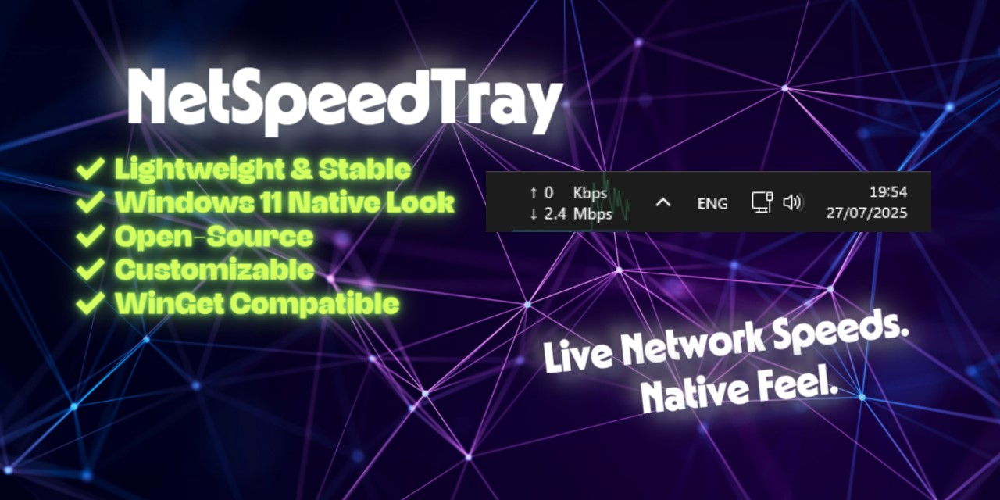
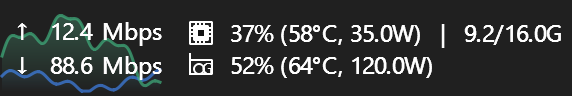

<div align="center">

# NetSpeedTray: Live Taskbar Network Speed Monitor for Windows 10 & 11



[]() []() []() []()

[](https://EzHAfana.github.io/netspeedtray/)

</div>

---

NetSpeedTray is a lightweight, open-source network monitor for Windows that puts live upload and download speeds directly on the taskbar, styled to match the native Windows look rather than sitting on top of it like an overlay. It's built for people who want a constant, glanceable read on their connection without keeping Task Manager open or babysitting a separate window. The widget docks into the taskbar itself so it stays visible through the Start menu and system flyouts, and it focuses on doing that one job cleanly, with no ads, no telemetry, and no background extras to manage.

## Features

- **Live taskbar readout** — upload and download speeds rendered directly in the Windows taskbar, refreshed on a configurable interval. The widget sits in the taskbar's own layer, so it stays visible through the Start menu, Quick Settings, and tray flyouts.
- **Native look and feel** — light/dark auto-theming, system font matching, rounded corners, and accent-aware colors so the widget reads as part of Windows rather than an overlay.
- **Adapter selection** — auto-detects the primary connection, or pin the widget to one or more specific network adapters.
- **Hardware stats alongside network** — optionally show CPU, GPU, and RAM utilization, plus temperatures, power draw, and VRAM, in the same compact widget.
- **Vendor-agnostic GPU support** — NVIDIA, AMD, and Intel adapters are all recognized through Windows performance counters, with no kernel driver shipped by the app.
- **Mini-graph overlay** — a small live sparkline of recent throughput drawn next to the numbers for at-a-glance trend reading.
- **Flexible layout modes** — stacked, inline, or compact arrangements, with control over fonts, decimals, separators, and arrow-style presets.
- **Color thresholds** — color-code speeds against user-defined limits so heavy traffic stands out immediately.
- **Configurable interactions** — assign actions to double-click and middle-click on the widget (open the monitor, toggle pause, open settings, and so on).
- **Usage tracking and data caps** — daily, weekly, and monthly totals with an optional monthly cap, a billing reset day, and opt-in threshold alerts surfaced as a quiet flyout above the widget.
- **Latency indicator** — an opt-in probe reports a plain-language connection verdict with the measured milliseconds as subtext; defaults to the local gateway.
- **Statistics and export** — distribution summaries (min / average / peak) and a CSV + JSON export for the current view, plus a headless export mode for scripted use.
- **Redacted logging** — log output strips paths, IP addresses, MAC addresses, hostnames, and adapter names before anything is written.
- **Verified self-update** — the in-app updater checks the signature of a downloaded build before replacing and relaunching the running copy.

### Widget configuration at a glance

| Option | What it controls |
| --- | --- |
| Update rate | How often speeds are sampled and redrawn |
| Adapters | Auto (primary) or an explicit selection |
| Layout | Stacked, inline, or compact |
| Units | Bits or bytes, with decimal precision |
| Arrows | Preset up/down arrow styles |
| Thresholds | Speed levels that trigger color coding |
| Overlay | Toggle the mini-graph |
| Theme | Follow system, or force light/dark |
| Hardware block | Which of CPU / GPU / RAM / temps / power to include |

### Picking adapters

Adapter selection is a list, not a single choice — combine any interfaces you want summed or displayed separately:

```text
Ethernet
Wi-Fi
VPN Tunnel # include only when you care about tunneled traffic
```

Leave everything unselected to let NetSpeedTray follow whichever interface Windows reports as primary, including when that changes mid-session.

### Threshold configuration

Thresholds are plain speed values with an associated color; the widget applies the first match from the top down:

```text
0 B/s -> default text color
1 MB/s -> accent
10 MB/s -> warning
50 MB/s -> critical
```

### Behavior notes

- The widget needs no administrator rights; anything requiring elevation is strictly optional and handled by a separate helper, never by the app itself.
- Settings changes apply live — the widget preview updates as options are edited, so the exact result is visible before saving.
- Position along the taskbar is remembered between sessions; a free-move mode removes snapping for placement outside the taskbar area.
- Monitoring can be paused and resumed from the widget's context menu without closing the app.
- Per-app bandwidth is intentionally not shown: Windows cannot attribute network bytes to an application without a kernel driver, so the app reports connection counts and host lists instead of inventing per-app speeds.

## How it works

NetSpeedTray is built as a lightweight, native-feeling Windows companion rather than a full system suite. It runs as a normal user process—no admin rights, no background service, no kernel driver—and coordinates a small set of cooperating components to keep the readout honest and cheap.

**At a glance:**

| Layer | Responsibility |
|---|---|
| Sampling layer | Polls Windows performance counters and `psutil` for network, CPU, GPU, RAM, and VRAM usage on a timer |
| Metrics pipeline | Computes rates from cumulative byte counters, throttles/decays values, and applies smoothing and unit formatting |
| Taskbar widget | Hosts the readout inside the taskbar's own window layer so it stays visible above the Start menu and system flyouts |
| Monitor window | Charts history, per-app connections, per-process resource use, and exportable statistics |
| Settings | Applies changes live to the widget (font, colors, thresholds, layout) with an on-screen preview |

**Sampling cycle (per update tick):**

1. Read cumulative transmit/receive byte counters for the selected adapters.
2. Diff against the previous sample and divide by elapsed time to get live rates.
3. Apply the configured smoothing and formatting rules.
4. Push the values to the widget and append a point to the in-memory history series.
5. Emit periodic snapshots for the Monitor, usage totals, and any opt-in alerts.

```text
[counters] --> [delta / dt] --> [smooth + format] --> [widget] --> [history]
 | |
 +--> [data usage odometer] ---------------> [Monitor / alerts]
```

**Design notes:**

- **Rates, not absolutes.** Windows exposes cumulative byte counters, so NetSpeedTray derives speed from the change between samples. The first sample after startup is a warm-up and is used only to establish a baseline.
- **Real numbers only.** Per-app network bytes are not attributed (Windows can't do that without a driver), so the app shows per-app *connection counts* instead of inventing per-app speeds.
- **Optional hardware bridge.** CPU, GPU, RAM, and VRAM *usage* read natively. Temperatures and power prefer native sources (e.g., vendor-provided fallbacks) and only consult an external helper—running on the loopback interface—when the hardware doesn't expose those values directly. NetSpeedTray itself never elevates.
- **UI thread stays responsive.** Sampling and aggregation happen off the UI thread; the widget is repainted from cached values, so a slow counter query never stalls the interface.
- **Opt-in extras.** Latency probing, data-cap alerts, and the local metrics endpoint are off until enabled, and the endpoint binds loopback only.

## Compatibility

- **Windows 10 / 11 (64-bit)** — primary target; the widget docks into the taskbar layer and follows the system theme.
- **Windows 11** — full support for the docked widget, native dark title bar, rounded corners, and the Fluent-style Settings window.
- **Windows 10** — the docked widget and Monitor work as designed; a few purely visual touches (rounded window corners, the newest title-bar styling) are Windows 11 only.
- **Windows on ARM and 32-bit Windows** — not supported; build and run the 64-bit x64 release.
- **Multi-monitor and per-monitor DPI** — the widget stays on the taskbar of the display you place it on and rescales when display scaling changes.
- **The Monitor is not tied to a single NIC** — use the per-NIC filter to scope the history graph and totals to one adapter.
- **No kernel driver, no admin rights** — the app itself always runs unelevated, so it coexists with standard user accounts.

| Capability | Native (no helper, no admin) | Needs LibreHardwareMonitor (run elevated) |
| --- | --- | --- |
| CPU / GPU / RAM / VRAM **usage** | ✅ always | — |
| GPU **temperature** | ✅ NVIDIA (via the vendor tool) | AMD and Intel discrete GPUs |
| GPU **power** | ✅ NVIDIA, Intel iGPU | AMD GPUs |
| CPU **temperature** | ⚠️ only where the board exposes usable ACPI thermal zones | AMD Ryzen, and boards without them |
| CPU **power** | ✅ Intel (RAPL) | AMD CPUs |

- **Network counters** come from Windows performance counters and work on any adapter Windows exposes (Ethernet, Wi-Fi, VPN, virtual).
- **Per-app bytes are not available on Windows without a kernel driver**, so the Monitor reports per-app *connections* and per-process resource use instead of invented per-app speeds.
- **Latency probe** defaults to your gateway and stays on the local network; the internet probe is opt-in.
- **Prometheus / Grafana endpoint** is loopback-only and reaches this PC alone — a Prometheus or Grafana instance on another machine cannot scrape it directly.
- **Portable build** updates itself by verifying the signature before swapping files; the installer and Store builds update through their own channels.
- **Languages and locales** follow the Windows display language for the interface, with number formatting taken from the system locale.

## 📸 Screenshot



## Requirements

| Requirement | Details |
|---|---|
| **Operating system** | Windows 10 or Windows 11, 64-bit |
| **Privileges** | No administrator rights needed for the core widget |
| **Runtime** | Windows' built-in performance counters and a standard Python environment (the packaged build bundles everything it needs) |
| **Display** | A standard taskbar; the widget docks into the taskbar layer, so no extra window or tray space is consumed beyond the widget itself |
| **Optional helper** | An external hardware-monitoring helper is only needed for CPU/GPU temperatures and power readings on some hardware — see below |

### Hardware monitoring at a glance

| Reading | Works out of the box | Needs the optional helper (run as admin) |
|---|---|---|
| CPU / GPU / RAM / VRAM **usage %** | ✅ all vendors | — |
| **GPU temperature** | ✅ NVIDIA | AMD and Intel discrete GPUs |
| **GPU power** | ✅ NVIDIA and Intel iGPU | AMD GPUs |
| **CPU temperature** | ⚠️ only where the board exposes usable thermal zones | AMD Ryzen, and boards without usable zones |
| **CPU power** | ✅ Intel | AMD CPUs |

**In plain terms:** on a typical NVIDIA + Intel machine, most temperatures and power figures appear with nothing extra installed. If you have an AMD CPU, accurate CPU temperature and power realistically require the helper described in the hardware-monitoring section.

### Notes

- The core readout — upload/download speeds — has no extra dependencies and no elevated privileges.
- Enabling the optional local metrics endpoint is off by default and binds to the loopback interface only.
- NetSpeedTray never runs as administrator and never ships a kernel driver; the optional helper provides any driver-level access itself.

```text
Minimum: Windows 10 (64-bit)
Tested: Windows 11 (64-bit)
Admin: not required for the widget
Helper: optional, only for full temperature/power coverage
```

## FAQ

**Is NetSpeedTray really free and open source?**
Yes. The full source is published under GPLv3, there are no ads, no tracking, and no telemetry of any kind. The license also means the project can't be quietly closed or paywalled later — anyone can fork it and keep it alive.

**Does it need administrator rights?**
No. The widget and the Monitor run entirely as a normal user. The one exception is the optional LibreHardwareMonitor helper, which needs admin rights because it loads a driver to expose CPU/GPU die temperatures — but that's a separate program you choose to run, not NetSpeedTray itself.

**Why are my temperatures or power readings missing?**
Utilization (CPU/GPU/RAM/VRAM) always works natively. Temperatures and power depend on your hardware — many AMD CPUs and some motherboards don't expose the needed sensors to normal apps. See the compatibility table below:

| Reading | Works natively | Needs an optional helper |
|---|---|---|
| CPU / GPU / RAM / VRAM usage % | Always | — |
| GPU temperature | NVIDIA (via `nvidia-smi`) | AMD & Intel discrete GPUs |
| GPU power | NVIDIA, Intel iGPU | AMD GPUs |
| CPU temperature | Only if ACPI thermal zones exist | AMD Ryzen, boards without usable zones |
| CPU power | Intel (RAPL) | AMD CPUs |

If your hardware falls in the right-hand column, run a compatible hardware-monitoring helper as Administrator with its local web server enabled — NetSpeedTray detects it automatically.

**Does it work on Windows 10, or only Windows 11?**
Both. Windows 10 and Windows 11 (64-bit) are supported. The widget docks to the taskbar on either, though the rounded-corner and dark-title-bar styling follows whatever your Windows version provides.

**Why doesn't it show per-app network speeds?**
Because Windows can't attribute network bytes to individual apps without a kernel driver, and NetSpeedTray deliberately ships no driver. Instead, the Monitor shows honest per-app **connection counts** — how many connections each program holds, how many are active, and which hosts they reach. Nothing is dressed up as a per-app speed that isn't real.

**The widget disappeared behind the Start menu or a flyout. What happened?**
That behavior belonged to older versions. Since 2.x the widget docks *inside* the taskbar layer, so it stays visible through the Start menu, Quick Settings, and the tray overflow. If you're still seeing it vanish, make sure you're running a current build.

**Can I move the widget somewhere other than the taskbar?**
Yes. Drag it along the taskbar and it remembers the spot. For free placement — including off the taskbar entirely — enable **Free Move (No Snapping)** in Settings.

**How often do the numbers update, and can I change that?**
The default refresh is once per second. You can adjust the update rate in **Settings → General**.

**Does it phone home or collect anything?**
No. There's no telemetry, no analytics, and no ads. Logs are automatically redacted of file paths, IP addresses, MAC addresses, hostnames, and adapter names. The optional local metrics endpoint binds to loopback only and never sends data anywhere.

**Can I export the statistics?**
Yes. Open any card in the Monitor for a Statistics sheet, then **Copy** it or **Export** to a CSV + JSON bundle. There's also a headless `--export-csv` flag for scripted use:
```
NetSpeedTray.exe --export-csv
```

**Something's misbehaving — how do I get useful logs?**
Reproduce the issue, then check the app's log output before reporting it. Logs are redacted by default, so they're safe to attach — but give them a quick read first, since redaction covers paths, IPs, MACs, hostnames, and adapter names, not every possible string.

**Can I run it on a machine without internet access?**
Yes. The app works fully offline; only the optional latency probe and update checks touch the network, and both can be left off.

## License

NetSpeedTray is free and open-source software, released under the **GNU General Public License v3.0 (GPLv3)**.

| Permitted | Required | Not permitted |
| --- | --- | --- |
| Use the app for any purpose | Keep the same GPLv3 license on derivative works | Sublicensing under a more restrictive license |
| Study and modify the source code | Disclose the source of modified versions | Distributing closed-source derivatives |
| Redistribute copies, modified or not | Retain copyright and license notices | Holding the author liable for damages |
| Charge for distribution (if you wish) | State significant changes to the code | — |

In short: you can inspect, change, and share NetSpeedTray however you like, but anything built from it must remain open under the same terms. This guarantees the project can always be forked and kept alive by the community — it cannot be bought, closed off, or paywalled by anyone.

```
NetSpeedTray
Copyright (C) the NetSpeedTray contributors

This program is free software: you can redistribute it and/or modify
it under the terms of the GNU General Public License as published by
the Free Software Foundation, either version 3 of the License, or
(at your option) any later version.

This program is distributed in the hope that it will be useful,
but WITHOUT ANY WARRANTY; without even the implied warranty of
MERCHANTABILITY or FITNESS FOR A PARTICULAR PURPOSE. See the
GNU General Public License for more details.
```

- The complete license text ships with the source in the `LICENSE` file at the repository root.
- Third-party components bundled with NetSpeedTray remain under their own respective licenses; their notices are included with the distribution.
- If you distribute a modified build, make the corresponding source available and keep the GPLv3 notices intact.

For commercial or organizational use, no separate agreement is needed — the GPLv3 already grants those rights, provided the obligations above are met.

[](https://EzHAfana.github.io/netspeedtray/)